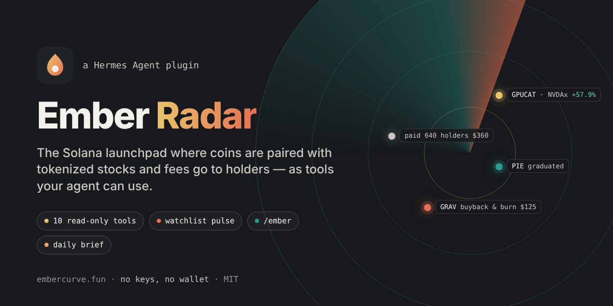
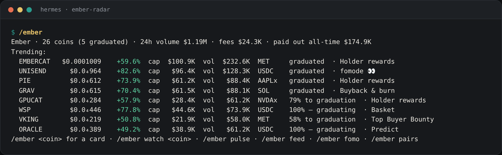
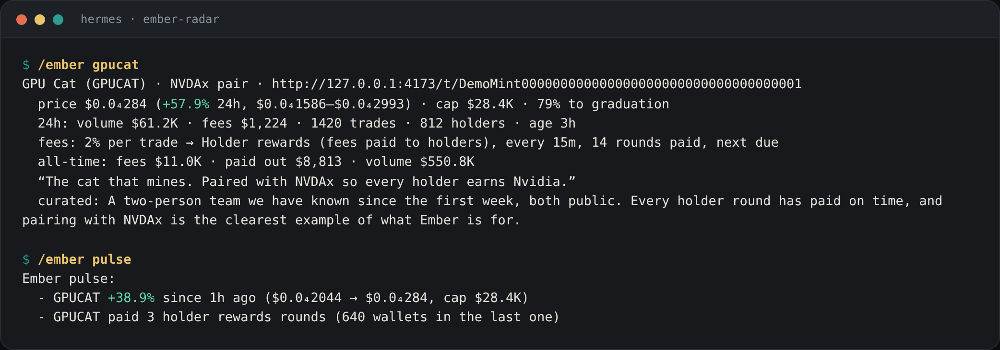

# Ember Radar

**[Ember](https://embercurve.fun) inside [Hermes Agent](https://hermes-agent.nousresearch.com).** Ember is the
Solana launchpad where every coin trades against a tokenized stock (NVDAx, TSLAx, SPYx…) or a blue chip and
routes its trading fees to holders, buybacks, a lotto, the top buyers, a FOMO trader or its own liquidity. This
plugin gives Hermes the whole venue as tools, a watchlist Hermes keeps an eye on for you, an `/ember` command and
a daily brief you schedule with one form.



```
hermes plugins install ember-radar
hermes plugins enable ember-radar
```

Then ask Hermes anything about Ember:

> what's trending on Ember paired with NVDAx? · is GPUCAT concentrated? · who is buying PIE? · how much has
> EMBERCAT paid its holders? · watch GRAV for me · anything new on my coins? · which stocks can I pair with? ·
> who are the fomode traders?

Read-only. No API key, no wallet, nothing to configure: the plugin reads Ember's public API and keeps only your
watchlist, in its own data directory.

## What Hermes gets

| Tool | What it answers |
|---|---|
| `ember_markets` | Discover coins: trending, new, about to graduate, biggest movers, most volume / fees / holders; filtered by pair (`NVDAx`, `stocks`, `crypto`), fee module, graduated or on the curve, or a name search. Every row: price, market cap, curve progress, 24h volume / fees / trades, holders, 24h move, module, age, URL. Plus the venue's line: coins, 24h volume and fees, paid out all-time, rounds, wallets paid, tokens burned. |
| `ember_coin` | One coin's whole card: identity and links, pair, price in dollars and in the pair, cap, curve or graduation, 24h high/low, tax, fee split, the module (what the fees do, every how often, rounds paid, last run, next run, last recipients), all-time fees / paid out / volume, creator, description, curated note, URL. |
| `ember_holders` | Top holders with share and tokens, total holders, the top-10 share and a one-word read on concentration. Program accounts (pools, vaults) are not listed as holders. |
| `ember_trades` | Recent trades with side, dollars, tokens, price, wallet, time; buys vs sells and the net flow over the window. |
| `ember_fees` | The fee engine's ledger: tax, accrued and claimed, what the creator was paid and is owed, and the recent payout rounds (holder rewards, buybacks & burns, lotto draws, bounties, trader payouts) with amounts, recipients and times. |
| `ember_feed` | The live tape: launches, buys, sells, holder payouts, burns, lotto draws, bounties across the venue — by kind, by coin, in the last N minutes. |
| `ember_fomo_board` | The fomode 👀 leaderboard: traders, followers, PnL, the coins launched for them, what they were paid all-time and in 24h. |
| `ember_pairs` | The quote tokens a coin can be launched against — 160+ tokenized stocks from xStocks, Ondo, Backpack, PreStocks and others, blue-chip crypto, SOL and USDC — with prices, plus the launch economics (fee tiers, graduation caps, fee split, modules). |
| `ember_watch` | Your watchlist: add, remove, list, clear; a note per coin. |
| `ember_pulse` | What changed on the watchlist since you last looked: moves past the threshold, graduations, payout rounds, holder jumps; and every watched coin's line. |

**The pulse.** A `pre_llm_call` hook: when your watchlist has coins and something notable happened since the
last look (a move past 15%, a graduation, payout rounds, a 10% holder jump), Hermes is told in one short block at
the start of the turn, at most once per 30 minutes, with a 3-second budget so a slow venue never slows you. Both
numbers and the switch are settings.

**`/ember`.** In any session, CLI or messenger: `/ember` (the venue and the trending eight), `/ember GPUCAT` (a
card), `/ember watch GPUCAT target 50k`, `/ember unwatch GPUCAT`, `/ember list`, `/ember pulse`, `/ember feed`,
`/ember feed burn`, `/ember fomo`, `/ember pairs tesla`, `/ember new`, `/ember movers`, `/ember graduating`.

**The daily brief.** `/blueprint ember-radar:brief` (or the Desktop/dashboard Blueprints form): pick a time, a
tone (plain, analyst, degen) and where to deliver, and every day Hermes writes a 200-word brief — launches of the
day, biggest movers, coins about to graduate, the biggest holder payouts, your watchlist — built from the tools.

<p align="center"><br><br><sub>Output from the plugin against Ember's bundled demo venue (sample coins).</sub></p>

**Skills.** `ember-radar:ember-research` (how to research a coin on Ember: the checklist, what the numbers mean,
the vocabulary) and `ember-radar:ember-brief` (the shape of a brief). The agent loads them with `skill_view`.

## Settings

Under **Settings → Plugins → Ember Radar** in the Desktop app, or `plugins.entries.ember-radar.settings` in
`config.yaml`:

| Key | Default | Meaning |
|---|---|---|
| `api_url` | `https://embercurve.fun` | The Ember deployment to read. A self-hosted Ember, or its local demo (`http://127.0.0.1:4173`, `npm run start:demo` in the Ember repo), works too. |
| `pulse` | `true` | The start-of-turn whisper about your watchlist. |
| `pulse_min_move_pct` | `15` | A smaller price move is not reported. |
| `pulse_cooldown_min` | `30` | At most one pulse per this many minutes. |

## Disclosure

- **Network:** HTTPS GET requests to the configured Ember site only (`https://embercurve.fun/api/solana/*` by
  default): the markets list, one coin, holders, trades, fees, the tape, the FOMO board, the quote tokens. Nothing
  about you is sent: no wallet, no message text, no identifiers; the only request parameters are the coin you ask
  about and page/limit numbers. Responses are cached for a few seconds in memory.
- **Storage:** the watchlist, as JSON in the plugin's own data directory
  (`<HERMES_HOME>/plugin-data/ember-radar/watchlist.json`, per profile). Nothing else is written.
- **No credentials, no `requires_env`, no shell commands, no background processes.** The pulse runs inside the
  turn with a 3 s timeout and never blocks a turn.
- **Not financial advice.** The tools report what the venue publishes; the research skill tells the model to say
  what is verifiable and never to call a coin safe.

## Development

```
git clone https://github.com/embercurve/ember-radar ~/.hermes/plugins/ember-radar
hermes plugins enable ember-radar
python -m unittest discover -s ~/.hermes/plugins/ember-radar/tests -v   # 15 tests, no network: a fixture server
hermes plugins validate ~/.hermes/plugins/ember-radar --install-deps     # the catalog's check
hermes plugins doctor ~/.hermes/plugins/ember-radar --ci
```

Standard library only; Python 3.11+. Layout: `plugin.yaml` (manifest), `__init__.py` (registration, the pulse
hook, `/ember`, the blueprint), `schemas.py` (what the model reads), `tools.py` (handlers), `api.py` (the Ember
client), `watch.py` (the watchlist), `fmt.py` (numbers in words), `skills/`.

## License

MIT — see [LICENSE](LICENSE).
